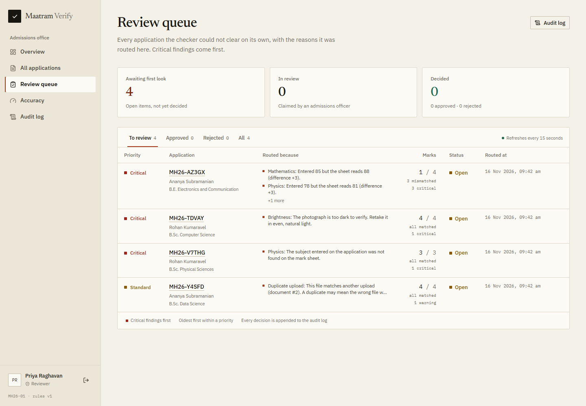
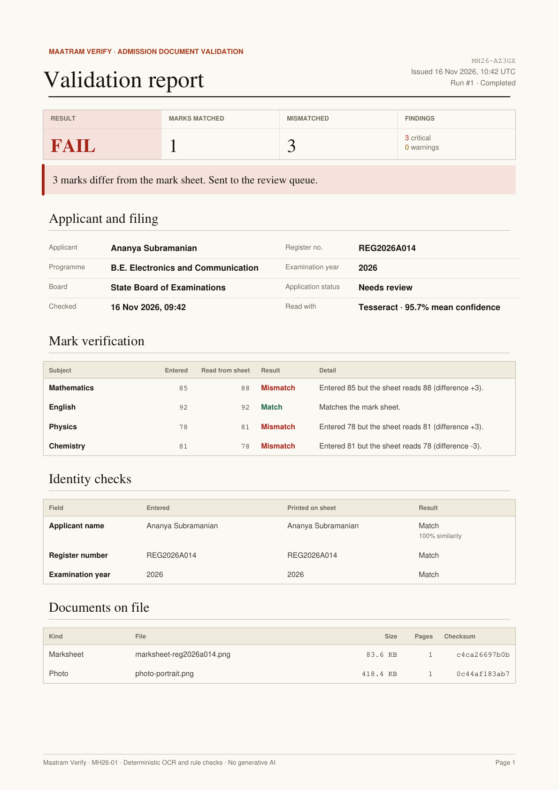
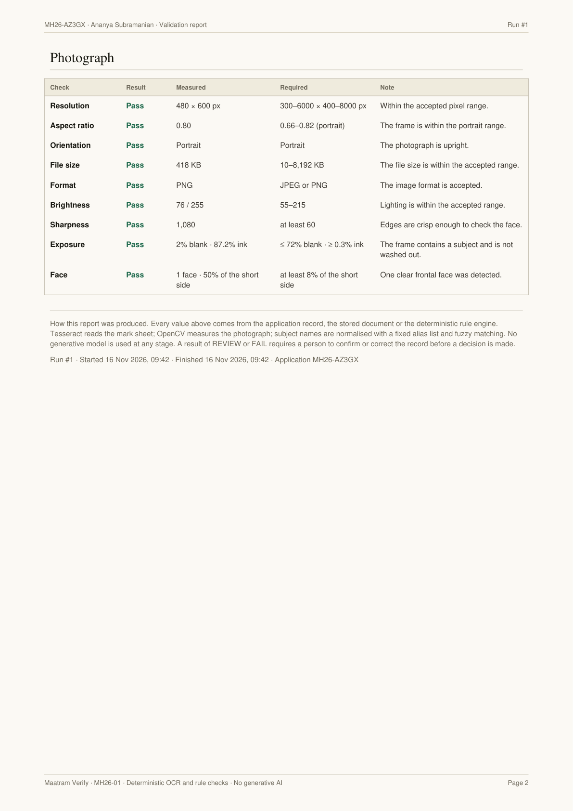

# Maatram Verify

**Smart admission document validation for Maatram HackForge 2026-27 · Problem MH26-01.**

Applicants enter their marks and attach a mark sheet and a portrait. Maatram
Verify reads the sheet, compares every subject, checks the photograph, looks for
duplicates and identity gaps, and sends only the exceptions to an admissions
officer. Clear applications are verified automatically; every decision, run and
download is auditable.

The pipeline is deterministic: Tesseract, OpenCV/Pillow, PyMuPDF, regex,
rapidfuzz and fixed rules. **No generative AI is used at any stage.**



## What it does

- **Reads real documents.** Magic-byte type checks, encrypted storage, 300 DPI
  PDF rendering, three Tesseract segmentation modes, adaptive preprocessing on
  low confidence, geometric field extraction and subject aliases with fuzzy
  matching.
- **Compares every mark.** Entered marks against the extracted sheet, with
  signed differences, OCR confidence and missing/extra subject detection.
- **Validates the photograph.** Resolution, aspect ratio, orientation, file
  size, format, brightness, sharpness, exposure and face presence, all with
  thresholds in one rule file.
- **Finds duplicates and identity gaps.** SHA-256 and perceptual-hash duplicate
  detection scoped to the applicant, plus printed name, register number and
  examination-year checks.
- **Routes exceptions to people.** A prioritised review queue, required decision
  notes, approve/reject actions and an append-only audit log.
- **Produces the PDF.** A two-page ReportLab report built from the stored run:
  verdict, entered-versus-read marks, identity, documents, measured photo values
  and a method note. Available only after a completed run.
- **Measures itself.** A reproducible synthetic benchmark covering clean, noise,
  blur, rotate, shadow and JPEG variants, with a live accuracy page.

## The report

| Page 1 — verdict and marks | Page 2 — photograph and method |
| --- | --- |
|  |  |

Every value in the PDF comes from the stored run, the extracted marks and the
measured photograph. The two pages are laid out with ReportLab; there is no
generated narrative.

## Stack

| Layer | Choice |
| --- | --- |
| API | FastAPI, SQLAlchemy 2, Pydantic 2, SQLite |
| OCR and images | Tesseract / pytesseract, OpenCV, Pillow, NumPy, PyMuPDF |
| Matching | rapidfuzz, explicit subject aliases and rule config |
| Reports | ReportLab |
| Frontend | React 19, TypeScript, Vite, Tailwind CSS 4, TanStack Query, Recharts |
| Auth and security | bcrypt, JWT, Fernet, RBAC, ownership checks, login rate limit |

## Quick start

### Prerequisites

- Python 3.12+
- Node.js 20+
- Tesseract 5 with the English training data, on `PATH` or in a standard install
  location. You can also set `TESSERACT_CMD` to the executable.

### Backend

```powershell
cd backend
python -m venv .venv
.\.venv\Scripts\Activate.ps1
pip install -r requirements.txt
.\.venv\Scripts\python.exe -m uvicorn app.main:app --host 127.0.0.1 --port 8000
```

On macOS/Linux, activate with `source .venv/bin/activate`.

Local defaults generate the JWT secret and Fernet key into `backend/data/` on
first use. Copy `.env.example` to `.env` only if you want to override settings.

### Frontend

```powershell
cd frontend
npm install
npm run dev
```

Open `http://127.0.0.1:5173`.

### Seed accounts and demo data

```powershell
cd backend
.\.venv\Scripts\python.exe scripts\seed.py --reset
```

| Role | Email | Password |
| --- | --- | --- |
| Admin | `admin@maatram.example` | `Admin@2026` |
| Applicant | `ananya@student.example` | `Student@2026` |
| Applicant | `rohan@student.example` | `Student@2026` |

The seed creates five applications covering every outcome: all-match, three
mark mismatches, a too-dark photograph, a missing subject and a duplicate
photograph. Four are validated during seeding so the queue and dashboard are
populated; the all-match application is left unrun for a live demonstration.

After a rehearsal or a live demo, restore that state without changing the
references:

```powershell
cd backend
.\.venv\Scripts\python.exe scripts\reset_demo.py
```

**The three-minute walkthrough is in [`DEMO.md`](DEMO.md).**

## Architecture

```text
backend/
  app/
    api/routes/      auth, applications, documents, admin, meta
    services/        validation orchestration, comparison, subjects,
                     storage, audit, evaluation, synthetic fixtures
    ocr/             Tesseract engine, preprocessing, field extraction
    validators/      photograph rules
    reports/         ReportLab PDF
    models/          SQLAlchemy records
    core/            config, security, rate limiting
    config/rules.yaml   every threshold and the required-subject list
  scripts/           seed, demo reset, evaluation helpers
  tests/             pytest suite

frontend/
  src/pages/         student and admin screens
  src/components/    validation, documents, review, shared UI
  src/lib/           API client, auth, status labels
  src/styles/        design system
  scripts/           dev-only browser checks and screenshot tools
```

Every validation run is a background task with its own database session. Passes
become **Verified**, warnings-only runs go to **Review**, and critical findings
become **Fail** and open a prioritised review item. A reviewer can approve or
reject with a required note; that decision is written to the audit log and sets
the application to **Approved** or **Rejected** rather than silently changing
the machine verdict.

## Tests and verification

```powershell
cd backend
.\.venv\Scripts\python.exe -m pytest -q     # 73 tests

cd ..\frontend
npm run build                              # TypeScript + production build
node scripts/layout-audit.mjs              # 12 pages × 4 widths
```

The synthetic evaluation is available to admins at `/admin/accuracy` and can be
regenerated into `backend/reports/accuracy.md`: 24 cases, 104/104 subjects read,
104/104 marks exact, 100% field extraction, 100% mismatch recall, 100%
photo-rule accuracy, 95.6% mean OCR confidence and roughly 0.7 seconds per
sheet.

## Security notes

- Passwords are bcrypt hashes; sessions are short-lived JWTs.
- Students can only read their own applications and documents; admin routes
  require the admin role.
- Uploaded files are magic-byte checked, encrypted with Fernet at rest, and
  served through ownership-checked routes.
- Login attempts are rate limited. Reports are served with `no-store`.
- The audit log records sign-ins, uploads, validation runs, downloads and review
  decisions. The product exposes no edit or delete path for audit entries.

## Deliberate limits

This is a hackathon prototype, not a production admissions system. It verifies
the printed name, register number and examination year; it does **not** perform
biometric face recognition, liveness detection or anti-spoofing. The corpus is
synthetic and English-language, the database is SQLite, and institution-specific
ERP integration, consent/retention policy and a mark-correction workflow are
future work. The photograph check is a document-quality signal, not proof of
identity.

## Assets

`backend/assets/portrait-standin.jpg` is the public-domain Grace Hopper
photograph from the Matplotlib sample-data collection, used only as a
deterministic stand-in for photo-rule fixtures and demo uploads. It is not a
student record. See `backend/assets/README.md`. All mark sheets are generated,
fictional documents.
